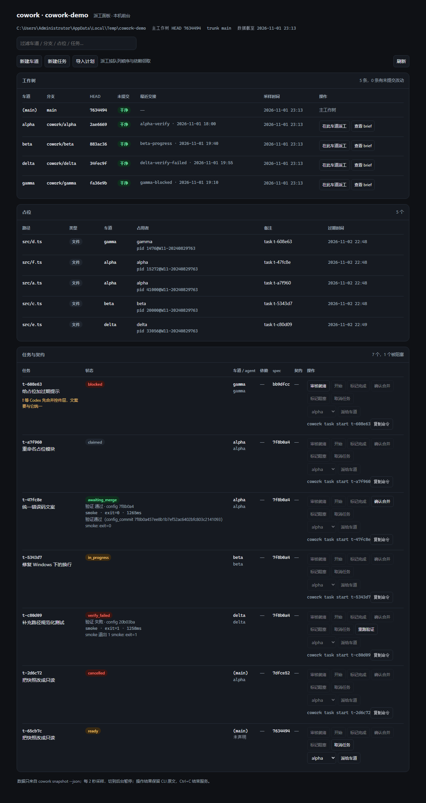

<h1 align="center">cowork</h1>

<p align="center"><strong>Run several coding agents in one repository — without stepping on each other.</strong></p>

<p align="center">
  
  <a href="https://github.com/palmer67/cowork/actions/workflows/ci.yml"></a>
  
  
  
  
</p>

<p align="center"><strong>English</strong> · <a href="README.md">简体中文</a></p>

> When three agents work on one repository, what actually costs you rework isn't a weak model — it's that none of them knows what the others are doing.

Codex edits `src/auth/login.ts`. Ten minutes later Claude Code edits the same file and silently overwrites it. The conflict only surfaces at merge time. Meanwhile the task list lives in a chat thread: who picked it up, how far it got, why it's stuck — someone has to ask. `cowork` adds exactly that coordination layer:

- 🚧 **Lanes** — one `git worktree` per agent, so they physically cannot write to the same tree;
- 🔒 **Claims** — file-level leases; a collision exits with code `2` and prints who holds the path, instead of printing a warning;
- 👀 **Shared state** — who holds what, which lane has uncommitted changes, where each task stands: one command, whole picture;
- 🧵 **Task queue** — specs live in the repo, `next` claims atomically, and a killed process picks up where it left off.

A CLI plus a single-file HTML board, with an optional local foreground control panel. No daemon, no containers, zero runtime dependencies.



## 30-second tour

```bash
cd your-repo
cowork init                      # writes .cowork/config.json, gitignores the lane dir
cowork lane new dsh              # give an agent its own lane (worktree)
cd .cowork/lanes/dsh

cowork claim src/auth/login.ts   # reserve the file you're about to edit; exit 2 if taken
cowork next                      # or: atomically claim a task from the queue
cowork ui --open                 # open the read-only board
```

That's the whole loop. The rest is organized by what you actually do with it.

## Three common paths

### 1. Two agents editing the same area

One lane and one terminal each:

```bash
# terminal 1
cd .cowork/lanes/dsh
export COWORK_AGENT_ID=dsh
cowork claim "src/auth/**"

# terminal 2
cd .cowork/lanes/codex
export COWORK_AGENT_ID=codex
cowork claim src/auth/login.ts
```

The second call fails immediately and tells you who holds it:

```
cowork: path already claimed: src/auth/login.ts <- /path/to/repo agent=dsh pid 14236@..., at 2026-10-30T15:45:20.186Z
  -> run `cowork status` for all claims; wait for `cowork release`, or pick a non-overlapping path.
```

Run `cowork release` when you're done. Claims expire after 24 hours by default, so a crashed agent cannot lock a file forever.

> There is no `claim --force`. Forcing a claim only lets two agents edit the same file and pushes the conflict to merge time. If you must take over someone else's claim, a human runs `cowork release --force <path>`, which prints the original holder first.

### 2. Hand a task to an agent

A task is a committable, reviewable spec plus a piece of shared live state.

```bash
cowork task add --title "Add login validation" \
  --touches src/auth/login.ts \
  --reads src/auth/token.ts \
  --done-when "npm test"

git add .cowork/tasks && git commit -m "task: add login validation"
cowork task ready t-1cb3e3        # requires the spec to be reachable on trunk
```

The worker picks it up inside a lane:

```bash
cowork next                       # FIFO, earliest runnable ready task; claims its touches
cowork task start t-1cb3e3
# ... edit, commit ...
cowork task report-done t-1cb3e3
```

Verify before merging (M2):

```bash
cowork task done t-1cb3e3         # runs the trunk verification config outside any lock
# pass -> awaiting_merge; fail -> verify_failed (lease and claims are kept), fix and re-run
cowork task confirm-merge t-1cb3e3 --commit 79195ba --manual --reason "reviewed by hand"
```

`report-done` is only "I am done"; merging straight from it is refused. The verification command comes from the `verification` block of `.cowork/config.json` **on the trunk commit** (default `npm test`), so editing it inside a lane cannot weaken the exam:

```json
{"schemaVersion":1,"verification":{"name":"test","argv":["npm","test"],"timeout_ms":600000,"enabled":true}}
```

`next` is not blocked while a verification runs, the board shows `verifying` plus the `run_id`, and `cowork doctor --fix` recovers a task whose CLI was killed back to `reported_done`.

<details>
<summary>Task state machine</summary>

```
draft --ready--> ready --next--> claimed --start--> in_progress
      --report-done--> reported_done --task done--> verifying
      --pass--> awaiting_merge --confirm-merge--> merged
      --fail--> verify_failed --task done--> verifying
```

`block` / `cancel` are called by the lease holder; `cancel` releases both the lease and the claims. `next` itself is a recoverable transaction: compute candidates -> take the lock -> roll back any unfinished transaction -> recompute -> write intent -> take lease -> claim files. All or nothing — even after a hard kill, the next locking command rolls it back.

Verification uses two short locks around the live state plus execution outside all locks: no lock is held while the command runs; afterwards the trunk, HEAD, dirty state and config are compared and the result is written only if nothing moved — otherwise it fails closed.
</details>

Before merging, rehearse it — without touching any worktree, HEAD, or ref:

```bash
cowork merge --dry-run dsh        # 0 mergeable / 2 conflicts; --json for scripts, --base for another base
```

Conflicts are reported by hunk line (`shared.txt  hunk 40-40 overlaps main's 42-42`), and the whole-file fallback used for binaries or deletions is labelled too.

### 3. See who is touching what

```bash
cowork status    # four-block dashboard: lanes, claims, tasks, hints (<=40 lines; --json untruncated)
cowork brief     # what this lane should do: task, deps, cross-lane conflicts, latest handoff
cowork doctor    # health check: expired claims, orphan leases, corrupt state files (exit 1 on problems)
```

The board is a single HTML file — no port, no state written:

```bash
cowork ui --open                 # render and open
cowork ui --watch --open         # rewrite every 2s in the foreground, Ctrl+C to stop
```

## Dispatch from the panel

Have an agent produce a plan, then review and import it. Example `plan.json`:

```json
{"schemaVersion":1,"tasks":[
  {"key":"token","title":"Migrate tokens","touches":["src/auth/token.ts"]},
  {"key":"login","title":"Validate login","touches":["src/auth/login.ts"],"reads":["src/auth/token.ts"],"depends_on":["token"],"done_when":["npm test"]}
]}
```

```bash
cowork task import plan.json --dry-run # preview IDs and paths, no writes
cowork task import plan.json --ready   # create drafts; only print ready commands
git add .cowork/tasks && git commit -m "task: project plan"
cowork task ready <id>                 # review each generated ID
cowork ui --serve --port 7788 --open
```

The panel creates lanes/tasks, imports plans, dispatches work, reads briefs, and confirms merges manually; `ready` is a human review action.
`start`, `report-done`, `block`, and `cancel` are enabled only when the panel identity matches both the lane and owner agent in the task snapshot.
Panel identity comes from the server process's `COWORK_AGENT_ID`, defaulting to `default`; on a mismatch, the controls are disabled and the task row
provides a copyable `cowork task start <id>` command to run from the owner lane CLI. The panel never fills in or impersonates an owner.
Dispatch uses FIFO and dependencies; each action runs one CLI subprocess. The result bar shows the raw exit code and output. Sequential repeat dispatch
returns 1 and the card retains the actual snapshot state.
The server binds only `127.0.0.1`, stays in the foreground, and stops on Ctrl+C. A busy port exits 3; choose `--port`.
The startup URL carries a random token, removed after the page reads it. Polling runs every 2s and pauses while hidden.
The static board remains available with copy-command buttons.

## Install

Requires **Node ≥ 22.6** and **git ≥ 2.40**. Zero runtime dependencies.

```bash
git clone https://github.com/palmer67/cowork.git
cd cowork
npm install && npm run build
npm link                 # puts cowork on PATH; or just use `node dist/cli.js <command>`
```

```bash
cowork version
```

## Command reference

| Command | What it does |
|---|---|
| `cowork init` | Initialize the repo (trunk branch, lane directory in `.gitignore`) |
| `cowork lane new <name>` | Create a `cowork/<name>` lane (worktree) |
| `cowork claim <path>...` / `cowork release` | Claim / release; `release --force` is how a human breaks a stale claim |
| `cowork status` / `cowork brief` | Global claim table / this lane's summary |
| `cowork snapshot --json` | Read-only snapshot for scripts and the board |
| `cowork ui [--watch]` | Render the single-file board |
| `cowork ui --serve [--port 7788] [--open]` | Local foreground control panel |
| `cowork task import <plan.json> [--dry-run] [--ready]` | Validate a plan and create drafts; ready only prints commands |
| `cowork task add / ready / show / ls` | Create a spec, promote it to ready, inspect the queue |
| `cowork next` | Atomically claim a ready task (and its files) |
| `cowork merge --dry-run <lane> [--base <ref>] [--json]` | Merge rehearsal: read-only, exit 0 when mergeable, 2 on conflicts |
| `cowork task start / report-done` | Start -> deliver |
| `cowork task done <id>` | Run the trunk verification: pass -> awaiting_merge, fail -> retryable |
| `cowork task confirm-merge` | Merge a verified task |
| `cowork task block / cancel` | Mark blocked / cancel (cancel releases claims) |
| `cowork doctor [--fix]` | Health check; `--fix` clears expired claims, reclaims leases, quarantines corrupt files |

Running `cowork` with no arguments prints the full usage.

## Exit codes

| Code | Meaning |
|---|---|
| `0` | Success (including idempotent refreshes) |
| `1` | General error: bad arguments, no claimable task, dependency not merged, corrupt state file |
| `2` | Busy or conflicting: claim collision, lost `next` race, duplicate lane |
| `3` | Environment not satisfied: not a git repo, git missing, path escapes the repo, Windows path too long (with a hint) |

Error messages always include **who holds it** and **how to resolve it**, so scripts can branch on the exit code alone.

## FAQ

<details><summary><code>cowork claim</code> exits 2 but nobody is around?</summary>

Run `cowork status` for the full table: the holder may be in another lane, or it may be your own earlier claim in another worktree. Once you're sure it's dead, a human runs `cowork release --force <path>`.
</details>

<details><summary>Do claims ever go away on their own?</summary>

Yes — they expire after 24 hours and any command reclaims them in passing. Liveness is TTL-only, never pid-based: every CLI invocation is a short-lived process, so pid checks would wipe a claim made seconds ago.
</details>

<details><summary><code>cowork next</code> says there is nothing to claim?</summary>

Three causes, each reported separately: no `ready` tasks, a dependency not yet `merged`, or the task's `touches` currently claimed by another lane. `cowork task ls` shows the queue.
</details>

<details><summary>Does it run on Linux / macOS?</summary>

The code is plain Node with no native dependencies, but the concurrency primitives are verified against Windows/NTFS semantics (directory locks, case-folded paths, `cmd /C` hooks). Other platforms are unverified.
</details>

## What it deliberately does not do

- No task decomposition, no LLM scheduling, no pushing tasks at agents — whoever works pulls with `cowork next`;
- No automatic fan-out; parallelism is bounded only by dependencies, `touches`, and claims;
- No write-side daemon or Electron; only explicit `ui --serve` opens a loopback port;
- No Docker / WSL, no background processes;
- No AST-level auto-merge; conflict detection stops at the file level;
- Never modifies the installation or binaries of Codex, Claude Code, DSH, or any other agent.

## Known limitations

- Claims are **file-level** only; no hunk or AST merge;
- Pull-only: cowork never launches an agent;
- Serialization is per repository; multiple repos are not coordinated;
- Deaths that get no signal (`taskkill /F`, power loss) leave the board at its last sample — the header always shows the data timestamp;
- On Windows, a working directory longer than 260 characters can stop the Node process from starting at all (a host limit) — move to a shorter path, or enable long paths and set `git config core.longpaths true`.

## Contributing

```bash
npm test                              # 175 tests: node:test against real git worktrees
npx tsc --noEmit                      # type check
npm run build                         # compile to dist/
node tools/mutex-gate.mjs             # concurrency gate: 8 processes x 1000 runs, zero overlap
node tools/accept-m1.mjs --with-build # M1 acceptance (10 checks)
node tools/accept-panel.mjs          # M1.5 acceptance (13 checks, includes test / tsc)
node tools/accept-m2.mjs             # M2 acceptance (20 checks: verify, recovery, contracts)
node tools/accept-m3.mjs             # M3 acceptance (10 checks: rehearsal, dashboard, paths, leftovers)
```

The source is TypeScript (ESM, `node:` prefixed imports). Tests run straight from source via `node --experimental-strip-types`. Design docs live in [`docs/`](docs/); handoff notes in [`.cowork/notes/`](.cowork/notes/) — cowork is managed by cowork itself.

CI runs the same gate on `windows-latest` (`.github/workflows/ci.yml`) and, every Monday, 20 extra rounds of the multi-process stress tests to catch flaky races.

## Docs

- [Plan: requirements, constraints, acceptance criteria](docs/PLAN.md)
- [Architecture: paths, claims, worktrees, failure modes](docs/ARCHITECTURE.md)
- [Task layer protocol: task object, dispatch, snapshot contract](docs/ARCHITECTURE-TASKS.md)
- [Control panel: processes, security boundary, API](docs/ARCHITECTURE-PANEL.md)
- [Decisions, including ones that were overturned and how to reproduce](docs/DECISIONS.md)

## License

MIT
