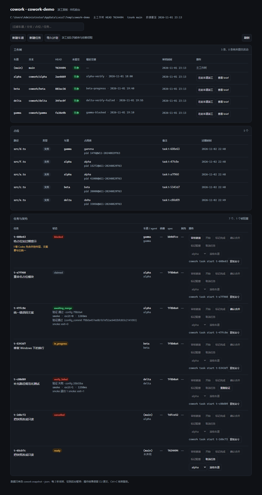

<h1 align="center">cowork</h1>

<p align="center"><strong>让多个 coding agent 在同一个仓库里并行干活，不踩脚、不丢活。</strong></p>

<p align="center">
  
  
  
  
  
</p>

<p align="center"><strong>简体中文</strong> · <a href="README.en.md">English</a></p>

> 同时开三个 agent 写一个仓库，真正让人返工的不是模型太笨，是它们互相不知道对方在干什么。

Codex 在改 `src/auth/login.ts`，Claude Code 十分钟后也改同一个文件，后写的把先写的盖了，冲突一路拖到 merge 才炸；任务派在聊天里，谁领了、做到哪一步、为什么卡住，全靠人问。`cowork` 补的就是这层协调：

- 🚧 **车道**：每个 agent 一个 `git worktree`，物理上写不到一起；
- 🔒 **占位**：文件级租约，撞车直接退出码 `2` 并打印谁占着，而不是一句警告；
- 👀 **共享状态**：谁占了什么、哪条车道有未提交改动、任务到哪一步，一条命令看全；
- 🧵 **任务队列**：spec 进版本库，`next` 原子领取，进程被杀也能接着干。

纯 CLI + 一个静态 HTML 看板，没有守护进程、没有容器、零运行时依赖。



## 30 秒上手

```bash
cd 你的仓库
cowork init                      # 建 .cowork/config.json，把车道目录写进 .gitignore
cowork lane new dsh              # 给一个 agent 开一条独立车道（worktree）
cd .cowork/lanes/dsh

cowork claim src/auth/login.ts   # 占住要改的文件；占不到就是退出码 2
cowork next                      # 或者：从任务队列里原子领一个任务
cowork ui --open                 # 打开只读看板，看全局
```

就这些。下面按「你能拿它干什么」展开。

## 三条常用路径

### 1. 两个 agent 改同一片代码

各开一条车道、各开一个终端：

```bash
# 终端 1
cd .cowork/lanes/dsh
export COWORK_AGENT_ID=dsh
cowork claim "src/auth/**"

# 终端 2
cd .cowork/lanes/codex
export COWORK_AGENT_ID=codex
cowork claim src/auth/login.ts
```

第二条会立刻失败，并告诉你谁占着：

```
cowork: 路径已被占用: src/auth/login.ts ← /path/to/仓库 agent=dsh 的 pid 14236@…，于 2026-10-30T15:45:20.186Z
  → 先运行 cowork status 看全部占位；等对方 cowork release，或换一条不冲突的路径。
```

改完 `cowork release` 放掉。占位默认 24 小时自动过期，所以 agent 崩了不会把文件永久锁死。

> 没有 `claim --force`。抢占只会让两个 agent 同时改同一个文件、把冲突推后到 merge；真要拆别人的位，由人运行 `cowork release --force <路径>`，它会先把原占用者打印出来。

### 2. 派一个任务出去

任务 = 一份能进版本库、能 review 的 spec + 一份共享的 live 状态。

```bash
cowork task add --title "补登录校验" \
  --touches src/auth/login.ts \
  --reads src/auth/token.ts \
  --done-when "npm test"

git add .cowork/tasks && git commit -m "task: 补登录校验"
cowork task ready t-1cb3e3        # 要求 spec 已在 trunk 上，防止「口头任务」
```

干活的人在车道里领：

```bash
cowork next                       # FIFO 领最早可干的 ready 任务，同时占好它的 touches
cowork task start t-1cb3e3
# …改代码、提交…
cowork task report-done t-1cb3e3
```

合并由人确认（M1 没有自动验证）：

```bash
cowork task confirm-merge t-1cb3e3 --commit 79195ba --manual --reason "人工确认"
```

<details>
<summary>任务状态机</summary>

```
draft ──ready──▶ ready ──next──▶ claimed ──start──▶ in_progress
      ──report-done──▶ reported_done ──confirm-merge──▶ merged
```

`block` / `cancel` 由领任务的人调用；`cancel` 会同时放掉 lease 和占位。`next` 本身是一条可恢复的事务：算候选集 → 取锁 → 回滚上次没写完的 → 重新算 → 写 intent → 占 lease → 占文件。要么全成，要么一条不写，强杀也能在下次命令时自动回滚。
</details>

### 3. 想知道现在谁在动什么

```bash
cowork status    # 当前占位表：路径、车道、占用者、过期时间
cowork brief     # 我这条车道该干什么：领的任务、依赖、跨车道冲突、最近交接
cowork doctor    # 体检：过期占位、孤儿 lease、损坏的状态文件（有问题退出码 1）
```

看板是单个 HTML 文件，不监听端口，也不写任何状态：

```bash
cowork ui --open                 # 生成并打开
cowork ui --watch --open         # 前台每 2 秒重写，Ctrl+C 退出
```

## 装一下

要求 **Node ≥ 22.6**、**git ≥ 2.40**，零运行时依赖。

```bash
git clone https://github.com/palmer67/cowork.git
cd cowork
npm install && npm run build
npm link                 # 放进 PATH；不想 link 就用 node dist/cli.js <命令>
```

```bash
cowork version
```

## 命令速查

| 命令 | 干什么 |
|---|---|
| `cowork init` | 初始化仓库（`trunk` 分支、忽略车道目录） |
| `cowork lane new <名>` | 建一条 `cowork/<名>` 车道（worktree） |
| `cowork claim <路径>...` / `cowork release` | 占位 / 释放；`release --force` 由人来拆别人的位 |
| `cowork status` / `cowork brief` | 全局占位表 / 本车道摘要 |
| `cowork snapshot --json` | 只读快照，供脚本和看板消费 |
| `cowork ui [--watch]` | 生成单文件看板 |
| `cowork task add / ready / show / ls` | 建 spec、进 ready、查队列 |
| `cowork next` | 原子领取一个 ready 任务（同时占文件） |
| `cowork task start / report-done / confirm-merge` | 开工 → 交付 → 合并 |
| `cowork task block / cancel` | 标阻塞 / 取消（取消会释放占位） |
| `cowork doctor [--fix]` | 体检；`--fix` 清理过期占位、回收 lease、隔离损坏文件 |

不带参数运行 `cowork` 会打印完整用法。

## 退出码

| 码 | 含义 |
|---|---|
| `0` | 成功（含幂等刷新） |
| `1` | 一般错误：参数不合法、没有可领的任务、依赖没 merged、状态文件损坏 |
| `2` | 被占用或冲突：占位撞车、`next` 竞争失败、车道重名 |
| `3` | 环境不满足：不在仓库里、找不到 git、路径越界 |

错误信息一律带**谁占着**和**怎么解决**，脚本可以直接按退出码分支。

## 常见问题

<details><summary><code>cowork claim</code> 报退出码 2，但我身边没人？</summary>

用 `cowork status` 看完整表：可能对方在另一条车道，也可能是你自己在别的 worktree 里占的。确认没人用了，由人 `cowork release --force <路径>`。
</details>

<details><summary>占位会一直锁着文件吗？</summary>

不会，默认 24 小时过期，任何命令都会顺手回收。存活只看 TTL、不看 pid——每次 CLI 都是短命进程，用 pid 判活会把刚占好的位当残留清掉。
</details>

<details><summary><code>cowork next</code> 说没有可领的任务？</summary>

三种原因，它会分别说明：没有 `ready` 任务、依赖还没 `merged`、`touches` 正被别的车道占着。`cowork task ls` 看队列。
</details>

<details><summary>能跑在 Linux / macOS 吗？</summary>

代码是纯 Node、无原生依赖，但并发原语按 Windows/NTFS 语义验证（目录锁、路径大小写折叠、`cmd /C` hook）。其它平台未验证。
</details>

## 它不做什么

- 不自动拆解任务、不做 LLM 调度、不主动唤醒或推送任务给 agent——谁干活谁自己 `cowork next`；
- 不做自动 fan-out；并行边界只由依赖、`touches` 和占位决定；
- 不做写操作后台，不用 Electron，不监听端口；
- 不用 Docker / WSL，不跑守护进程；
- 不做 AST 级自动合并，冲突检测只到文件级；
- 不修改 Codex、Claude Code、DSH 等 agent 的安装或二进制。

## 已知限制

- 占位只到**文件级**，不做 hunk / AST 级合并；
- 只能拉模式，cowork 不启动 agent；
- 串行化以仓库为单位，多个仓库之间不协调；
- `taskkill /F`、断电这类信号够不到的死亡，看板会停在最后一次采样（页头显示「数据截至 …」）。

## 参与开发

```bash
npm test                              # 109 个测试：node:test + 真实 git worktree
npx tsc --noEmit                      # 类型检查
npm run build                         # 编译到 dist/
node tools/mutex-gate.mjs             # 并发门槛：8 进程 × 1000 次，不许有一次重叠
node tools/accept-m1.mjs --with-build # M1 验收（10 条）
```

源码是 TypeScript（ESM，`node:` 前缀），测试用 `node --experimental-strip-types` 直接跑，不经编译。设计文档在 [`docs/`](docs/)，历次交接单在 [`.cowork/notes/`](.cowork/notes/)——cowork 自己也是用它自己管理的。

## 文档

- [目标计划：需求、约束、验收标准](docs/PLAN.md)
- [架构：路径、claim、worktree、失败模式](docs/ARCHITECTURE.md)
- [任务层协议：任务对象、派工单、snapshot 契约](docs/ARCHITECTURE-TASKS.md)
- [已定决策（含被推翻的决策与复现路径）](docs/DECISIONS.md)

## 许可

MIT
